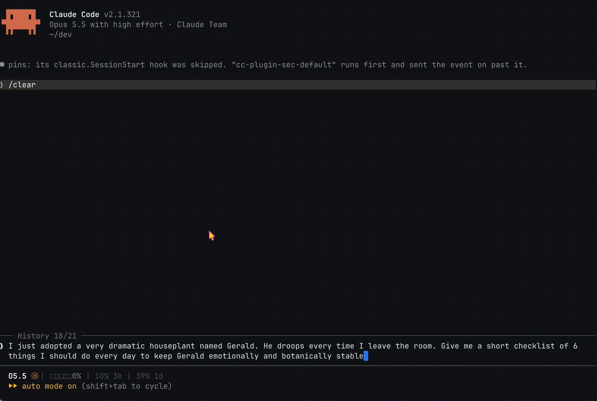

# Pins for Claude Code

I kept scrolling back up through long Claude Code sessions to find that one reply: the deploy checklist, the command that finally worked, the plan we agreed on. So I built Pins. Pin a reply, or just the part you selected, and it stays in a pane beside the chat, across sessions, one keypress away.



## What it does

- **Pin exactly what matters.** Drag over part of a reply and run `/pin`, or pin the whole last reply. The highlight vanishes when you type, but your selection is still remembered.
- **Pins keep their formatting.** You get the original markdown, with code blocks, lists and clickable links, not a flat copy of the screen.
- **Always beside the chat.** Pins live in a side pane that opens on its own when a session starts and you have pins saved.
- **Works across sessions.** Pin something in one session and open it from any other, in any project. Each pin shows when you saved it, which session it came from and the project folder, and session names stay current if you rename one.
- **Never in your way.** `/pin`, `/pins` and `/unpin` run instantly, even while Claude is mid-reply, and confirm with a toast instead of adding to your thread.
- **Keyboard first.** Arrow keys to move, `1`–`9` to jump, then copy, unpin or close with one key each.
- **Private by design.** Pins stay on your machine and the plugin makes no network requests.

## How I use it

| Run | What it does |
| --- | --- |
| `/pin [title]` | Pins what you selected with the mouse (fullscreen mode), or the last reply if nothing is selected. |
| `/pins` | Opens the Pins pane and puts focus in it. |
| `/unpin <number\|all>` | Removes a pin by its number in the list, or all of them. |

Inside the Pins pane (click it, or press `ctrl+x tab` to focus it):

| Key | What it does |
| --- | --- |
| ↑ / ↓ | Move between pins |
| Enter or `1`–`9` | Open a pin |
| `d` | Remove the focused pin |
| `r` | Refresh. Picks up pins you saved in another session and updates session names if you renamed one. This also happens on `/pins` and whenever you focus the pane. |
| `b` / `c` / `d` | In an open pin: back, copy, unpin |
| `x` | Close the pane. It stays closed in every session, and `/pin` won't pop it back open, until you run `/pins` again. |

## Install

At the prompt of a Claude Code terminal session:

```
/plugin install pins --marketplace eggei/claude-pins
```

Or from a shell:

```
claude plugin install pins --marketplace eggei/claude-pins
```

You'll need Claude Code 2.1.275 or later, in a terminal. The shell command needs 2.1.292 or later.

## Here is what I use in my own setup

Plugins can't ship key bindings, so these are up to you. This is what I have in my `~/.claude/keybindings.json`:

```json
{
  "bindings": [
    {
      "context": "Chat",
      "bindings": {
        "ctrl+x p": "command:pin",
        "ctrl+x up": "command:pins",
        "ctrl+x right": "command:pins"
      }
    },
    {
      "context": "Pane",
      "bindings": {
        "ctrl+x up": "command:pins",
        "ctrl+x right": "command:pins"
      }
    }
  ]
}
```

`ctrl+x p` pins, and `ctrl+x up` or `ctrl+x right` jumps me into the Pins pane from the chat input or from another pane.

A few things I learned the hard way:

- Keep them out of the `Global` context. A `ctrl+x` chord there can swallow the plain `ctrl+x` that agent view uses to stop a session.
- The `Pane` entries take over the default pane resize on those two keys. `ctrl+x left` and `ctrl+x down` still resize.
- Claude Code won't move focus out of a chat input that has text in it. If you have a draft typed, clear it first or use `ctrl+x tab`.

## Privacy

Your pins stay on your machine, in Claude Code's plugin storage. To show which session a pin came from, Pins reads the session titles from your local transcripts under `~/.claude/projects` (or `$CLAUDE_CONFIG_DIR/projects`). It makes no network requests. The only thing that leaves the terminal is a link you click, which opens in your browser.

## License

[MIT](LICENSE). Pins is a community plugin, not affiliated with or endorsed by Anthropic. If you find a bug or have an idea, open an issue. I'd love to hear how you use it.
